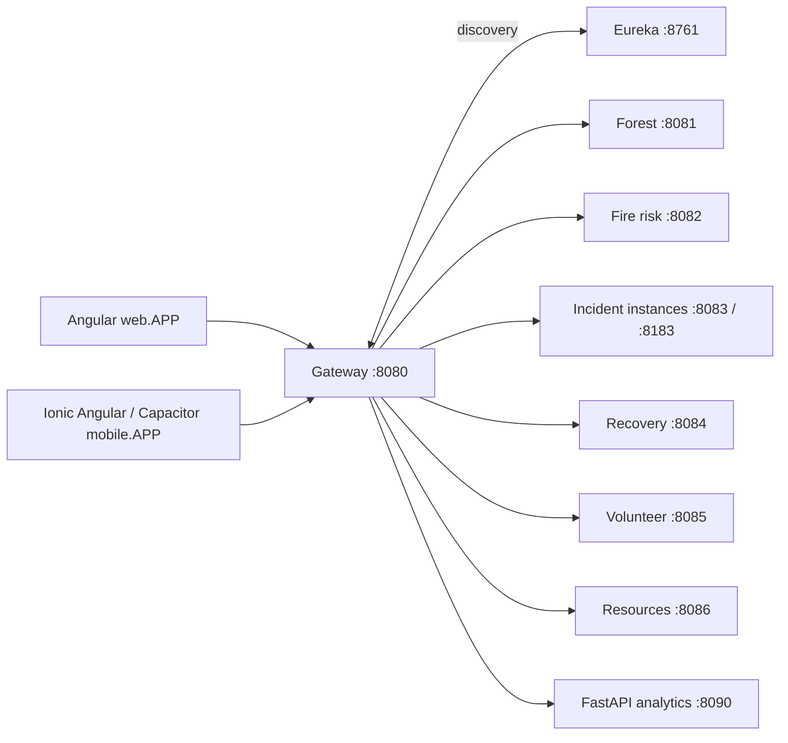

# Reverde integration guide

## Architecture and current scope

The implementation follows the boundaries and workflows in the architecture presentation.
Angular is the client framework selected for this increment; older diagrams mention React.



Eureka is a directory, not a proxy. All seven routes use `lb://` destinations.
Spring Cloud LoadBalancer selects instances with its default round-robin algorithm.
Its additional cache is disabled because Eureka already caches discovery results.
The connection timeout is three seconds; the response timeout is ten seconds.
Requests are not automatically retried, avoiding duplicate future mutations.

Delivered functionality is connectivity, discovery, routing, documentation, and client workspaces.
Domain CRUD, private PostgreSQL databases, RabbitMQ, Config Server, and Keycloak/JWT enforcement
are still planned. The UIs display actual connectivity results, not simulated business records.

## Route contract

| Public prefix | Eureka application | Default port | OpenAPI through gateway |
|---|---|---:|---|
| `/forests` | FOREST-BIODIVERSITY-SERVICE | 8081 | `/forests/v3/api-docs` |
| `/fire-risk` | FIRE-RISK-SERVICE | 8082 | `/fire-risk/v3/api-docs` |
| `/incidents` | INCIDENT-SERVICE | 8083 | `/incidents/v3/api-docs` |
| `/recovery` | RECOVERY-SERVICE | 8084 | `/recovery/v3/api-docs` |
| `/volunteers` | VOLUNTEER-SERVICE | 8085 | `/volunteers/v3/api-docs` |
| `/resources` | RESOURCE-SERVICE | 8086 | `/resources/v3/api-docs` |
| `/analytics` | ANALYTICS-SERVICE | 8090 | `/analytics/openapi.json` |

The first segment is removed before forwarding. `GET /incidents/hello` reaches incident-service
as `GET /hello`. A future controller path `/api/incidents` is reached publicly at
`/incidents/api/incidents`. A gateway route does not create a missing business endpoint.

## Start, check, and stop on Windows

Requirements: JDK 17+, Python 3.10+, Node compatible with Angular 22 (Node 24.15+ in the 24.x
line is supported), npm, and Git. Maven wrappers are included. Set `JAVA_HOME` to your JDK.

From `Backend`:

```powershell
./run-all.bat -InstallPython
./test-all.ps1
./stop-all.bat
```

The launcher builds classes, resolves dependencies, starts Eureka first, then the services and
gateway. Hidden processes, logs, and a PID/start-time manifest are stored in ignored `.runtime/`.
Occupied ports cause an error rather than terminating another application. The stop script only
stops recorded processes whose identity still matches this checkout. Stop IDE instances in IntelliJ.
After building successfully, `./run-all.bat -SkipBuild` starts faster.
The start command launches processes; the test command waits for discovery and validates the APIs.

For isolated verification without disturbing default ports:

```powershell
./run-all.bat -PortOffset 10000
./test-all.ps1 -PortOffset 10000
./stop-all.bat -PortOffset 10000
```

Gateway becomes 18080, Eureka 18761, Java business services 18081-18086, analytics 18090.

## Swagger and Postman

Open **http://localhost:8080/swagger-ui.html**. The selector contains all seven APIs.
Descriptions include module purpose, operation summaries, typed responses, examples, and UTC timestamps.
Only implemented endpoints are advertised: Java `/hello`, analytics `/hello` and `/health`.

Java services process forwarded host/protocol/prefix headers so generated server URLs point back
through the gateway. Analytics uses a relative `/analytics` server when its description is requested
through the gateway. **Try it out** therefore sends requests through the gateway too.

Import `postman/Reverde-Gateway.postman_collection.json`, set the `gateway` collection variable,
and run its seven requests. Each checks HTTP status and destination service identity.

Portable, generated OpenAPI snapshots are included under `documentation/openapi/`. Regenerate
them from a running stack with `Backend/scripts/Export-OpenApi.ps1 -Gateway http://localhost:8080`.
Their server paths are relative to the gateway origin; runtime Swagger remains authoritative.

Every gateway request receives an `X-Request-Id`. Valid client IDs are preserved and forwarded;
missing or invalid IDs are replaced. The response header can be used for troubleshooting.

## Angular web and mobile

From `Frontend`:

```powershell
npm ci
npm start
# In another terminal:
npm run start:mobile
```

Web: **http://localhost:4200**. Mobile browser preview: **http://localhost:8100**.
Both clients use `shared/api.ts` and `shared/gateway-url.ts`. No business-service address is embedded
in client code. The development proxy forwards public service prefixes to localhost:8080.
The clients provide module selection, unchecked/loading/success/failure states, actual response
inspection, elapsed time, connection settings, and unified Swagger access.

`npm run build` builds both clients. `npm test` checks shared destination construction/validation.
For deployment configure the application's `public/config.json` before building, or use its
Connection settings. Settings persist per device origin.
An empty web gateway origin requires the hosting reverse proxy to forward service prefixes,
`/swagger-ui.html`, `/webjars/**`, and `/v3/**` to the gateway. Alternatively configure an explicit
HTTPS gateway origin and include the web host in gateway CORS.

### Native mobile

`mobile.APP` uses Ionic Angular and Capacitor. Android native source is included.

```powershell
npm run mobile:sync
npm run mobile:android
```

APK compilation requires Android Studio/SDK and the JDK required by the generated Gradle project.
Android emulator default: `http://10.0.2.2:8080`. On a physical phone, use the computer's LAN gateway
address (for example `http://192.168.1.20:8080`), allow the port through the host firewall, and connect
both devices to the same network. Device `localhost` refers to the device itself.
The Android shell permits HTTP for local workshop use. Use HTTPS and disable `server.cleartext`
for a release. To generate iOS source, run `npx cap add ios` in `mobile.APP`; iOS builds require macOS/Xcode.

## Environment configuration

| Setting | Component | Default / purpose |
|---|---|---|
| `EUREKA_URL` | Gateway and services | `http://localhost:8761/eureka/` |
| `SERVER_PORT` | Business services | Per-service default |
| `GATEWAY_PORT` | Gateway | 8080 |
| `SERVICE_HOST` | Registration | localhost; change for distributed/container hosts |
| `SERVICE_IP` | Python registration | 127.0.0.1; change alongside host when distributed |
| `EUREKA_ENABLED` | Python | true; false for offline tests |
| `CLIENT_ORIGINS` | Gateway CORS | Angular 4200, Ionic 8100, Capacitor local origins |

Use comma-separated explicit origins for CORS. Add LAN development/browser origins explicitly.
The gateway validates CORS before routing and removes the Origin request header downstream;
legacy per-service React CORS settings therefore cannot reject an already accepted mobile request.
Instance IDs include host, application, and port, allowing simultaneous replicas.
The registry remains standalone, with self-registration disabled and self-preservation enabled.

## Demonstrate load balancing

With the default stack running, start another incident instance from its service directory:

```powershell
./mvnw.cmd spring-boot:run '-Dspring-boot.run.arguments=--server.port=8183'
```

After registry refresh both instances should appear under INCIDENT-SERVICE. Repeated public
requests report the actual responding port:

```powershell
1..8 | ForEach-Object { (Invoke-RestMethod http://localhost:8080/incidents/hello).port }
```

Alternatively, `Backend/scripts/Test-LoadBalancing.ps1` launches a temporary replica, verifies
traffic reaches two real instances, and stops its replica in a finally block. Pass
`-PortOffset 10000` to verify the isolated integration stack.

Graceful shutdown deregisters a service. Crash detection and registry cache refresh take time;
self-preservation can retain stale instances during low heartbeat activity. Load balancing does
not guarantee immediate failover during that window.

## Verification and troubleshooting

- Service tests cover identity, typed schemas, and gateway-relative generated server URLs.
- Gateway tests route to two real HTTP instances through a test discovery client. They cover all
  prefixes, query preservation, round robin, correlation headers, Swagger, CORS, 404, and 503.
- Python tests cover health, identity, and direct/gateway OpenAPI server addresses.
- `Test-Reverde.ps1` checks real Eureka-backed routes and all seven documentation endpoints.
- Angular production builds validate both clients' templates and TypeScript.

404: route or endpoint absent. 503: no discovered instance. Connection failures may indicate an
unreachable advertised host. Check Eureka, logs, and request IDs. Browser-only failures can be CORS
or an incorrect device gateway address. A root URL can return 404 because there is no homepage.

## Product backlog and team handoff

Suggested dependency order:

1. Agree domain endpoint contracts and implement persistence per module.
2. Select/configure identity provider and enforce JWT/role rules at the gateway.
3. Add real domain workflows to web/mobile, including incident reporting and map views.
4. Implement the documented asynchronous events and recovery consumers.
5. Add deployment profiles/Compose, reachable service hosts, and HTTPS ingress.

Shared gateway changes should be reviewed by module owners. Run acceptance checks before merging
the integration branch into dev. The delivered gateway has no authentication enforcement yet.
